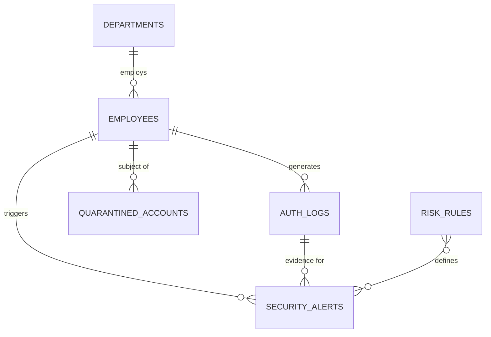

# Project F.R.I.D.A.Y.
### In-Database SIEM & Identity Threat Detection Engine
*Dynamic risk scoring and automated account quarantine, modeled on the Equity Bank Rwanda fraud of February 2026*


| | |
|---|---|
| **Student** | MUTABOBA Elois |
| **Student ID** | 20252SEN241 |
| **Course** | INSY 8311 – Database Development with PL/SQL |
| **Instructor** | Eric Maniraguha |
| **Repository** | `Project-F.R.I.D.A.Y` |

---

## Table of Contents
1. [Problem Statement](#problem-statement)
2. [Objectives](#objectives)
3. [System Overview](#system-overview)
4. [Data Source](#data-source)
5. [Innovation: Dynamic Risk-Scoring & Automated Quarantine](#innovation-dynamic-risk-scoring-engine--automated-account-quarantine)
6. [Database Design](#database-design)
7. [Planned PL/SQL Features](#planned-plsql-features)
8. [Folder Structure](#folder-structure)
9. [Getting Started](#getting-started)
10. [Roadmap](#roadmap)

---

## Problem Statement

### Real-world scenario: Equity Bank Rwanda, 14–18 February 2026

Between **14 and 18 February 2026**, a criminal network is alleged to have breached the systems of **Equity Bank Rwanda** and drained roughly **Rwf 4.7–4.9 billion (≈ US$3.2–3.4 million)**, reportedly by exploiting the bank's mobile-money float system. Investigators arrested **35 suspects**, including **two IT employees in data-centre operations**, which points to insider involvement. The bank only publicly disclosed the suspicious activity on **15 March 2026**, about a month after the fraud window. It said most transactions were reversed within 24 hours and that no customer funds were lost.

### Why it matters for this project

The attack window began on **Saturday, 14 February**, outside normal working hours, and ran through the following days. Activity like this is exactly what a static, perimeter-based log collector tends to catch late:

- **After-hours access** by accounts that normally work office hours goes unnoticed until a person reviews the logs.
- **Insider credentials** look legitimate, so a single rule (e.g. "wrong password") never fires.
- **Detection latency** (here, weeks to public disclosure) lets funds move before the account is stopped.

> **Scenario note:** Public reports describe the insider involvement and the 14–18 February window. They do not publish the login-level details, so the after-hours logins in this project are a **simulated reconstruction** of the scenario using synthetic data, not real Equity Bank logs.

### The problem this project solves

Enterprises need identity-threat detection **inside the data layer**, where it can react immediately. This project builds an Oracle PL/SQL engine that ingests normalized authentication logs, **scores every login with a dynamic risk score** (after-hours time, failure bursts, location mismatch), **automatically quarantines** accounts that cross the critical threshold, and keeps immutable audit trails.

---

## Objectives

**Main objective:** Build an Oracle PL/SQL engine that ingests authentication logs, evaluates identity-risk rules, automatically quarantines compromised accounts, and alerts security engineers.

**Specific objectives**

1. Design a normalized (**3NF**) schema for departments, employees, authentication logs, and security alerts with no redundancy.
2. Develop a modular PL/SQL package with a **dynamic risk-scoring engine** that detects **after-hours logins** (the Equity Bank Rwanda scenario), **brute-force attacks**, and **office-vs-country geolocation mismatches** in real time.
3. **Automatically quarantine** high-risk accounts through triggers and **autonomous-transaction logging** (`PRAGMA AUTONOMOUS_TRANSACTION`) to lock compromised identities and preserve evidence that survives rollbacks.
4. Schedule a nightly job with `DBMS_SCHEDULER` to evaluate daily threat metrics, identify repeat-offender IP subnets, and publish security summaries.

---

## System Overview

 .png)

---

## Data Source

| Item | Details |
|---|---|
| **Dataset** | Cybersecurity SQL Lab – Authentication & Employee Dataset |
| **Link** | https://github.com/JQCVSC/Cybersecurity-SQL-Lab |
| **Contents** | Authentication attempt logs (`log_in_attempts`) and organizational employee records (`employees`) |
| **Licence** | MIT (open educational, academic, and development use) |
| **Personal data** | None – simulated usernames (e.g. `jsmith`, `ajonson`), synthetic device IDs, mock IP ranges |

---

## Innovation: Dynamic Risk-Scoring Engine + Automated Account Quarantine

Instead of fixed pass/fail rules, every login is evaluated by a **dynamic risk score (0–100)** that combines weighted signals read from the `Risk_Rules` table, so analysts can tune detection without changing code.

| Signal | Example from the Equity Bank scenario | Effect |
|---|---|---|
| **After-hours login** | Staff account active on Saturday 14 Feb, outside working hours | Adds `score_weight` for the rule |
| **Failure burst** | 3 or more failed logins within a 5-minute rolling window | Adds weight, scaled by failure count |
| **Geo/office mismatch** | Login from a country other than the employee's office | Adds weight |
| **Compounding** | Several signals in the same session | Scores add up (capped at 100), so a "normal-looking" insider login still escalates |

**Automated quarantine:** when the score reaches the **critical threshold**, the engine writes a `CRITICAL` alert. The trigger `trg_quarantine_account` then sets `Employees.account_status = 'LOCKED'` and records the case in `Quarantined_Accounts`. The evidence is written with `PRAGMA AUTONOMOUS_TRANSACTION`, so it survives any rollback in the calling session. The whole chain runs in the database, in sub-seconds, without waiting for an administrator.

**Supporting tools:** `DBMS_SCHEDULER` runs a nightly 23:59 summary of daily threat metrics and repeat-offender IP subnets.

---

## Database Design

### Planned tables

| # | Table | Key columns |
|---|---|---|
| 1 | `Departments` | `department_id`, `department_name`, `office_code`, `building_location` |
| 2 | `Employees` | `employee_id`, `username`, `email`, `department_id`, `device_id`, `account_status` |
| 3 | `Auth_Logs` | `log_id`, `employee_id`, `login_timestamp`, `ip_address`, `country`, `success_flag` |
| 4 | `Security_Alerts` | `alert_id`, `employee_id`, `log_id`, `alert_type`, `severity`, `detected_at`, `status` |
| 5 | `Risk_Rules` | `rule_id`, `rule_name`, `score_weight`, `threshold_value`, `is_active` |
| 6 | `Quarantined_Accounts` | `quarantine_id`, `employee_id`, `reason`, `locked_at`, `unlocked_at`, `unlocked_by` |
| 7 | `Audit_Log` | `audit_id`, `action_name`, `executed_by`, `event_timestamp`, `details` |

### Entity relationships



---

## Planned PL/SQL Features

| Component | Name | Purpose |
|---|---|---|
| **Procedure** | `log_auth_event` | Ingests each login attempt, runs anomaly checks, updates employee state, and records the event in `Auth_Logs`. |
| **Function** | `calculate_risk_score` | Dynamic scoring engine: returns a composite threat score (**0–100**) from rolling failure count, after-hours windows, and geographic office mismatches, using weights from `Risk_Rules`. |
| **Cursor** | Explicit cursor | Loops through active employees with high risk scores to summarize multi-vector attacks. |
| **Package** | `auth_security_pkg` | Encapsulates the engine API: login ingestion, threat scoring, account lockdown, and analyst alert generation. |
| **Trigger** | `trg_quarantine_account` | On critical alert creation, sets `Employees.account_status = 'LOCKED'` and writes to `Quarantined_Accounts`. |
| **Exceptions** | `e_unknown_employee` and others | Handle unmapped employees, malformed IP addresses, duplicate active sessions, and unauthorized status changes. |
| **Scheduler job** | Nightly at **23:59** | Aggregates 24-hour threat stats, flags high-risk IP subnets, and archives resolved alerts. |

### Detection rules (inputs to the risk score)

| Rule | Signal |
|---|---|
| Brute force | 3 or more failed logins within a 5-minute rolling window |
| After-hours access | Login outside the employee's permitted time window (including weekends) |
| Geo mismatch | Login `country` differs from the employee's office country |

---

## Folder Structure

```text
.
├── data/
│   └── sample_auth_logs.sql
├── docs/
│   ├── research/
│   │   └── log_management_standards.md
│   ├── proposal/
│   │   └── project_proposal.pdf
│   └── presentation/
│       └── slides.pdf
├── sql/
│   ├── 01_schema_ddl.sql
│   ├── 02_seed_data.sql
│   ├── 03_security_package.sql
│   ├── 04_triggers_and_rules.sql
│   └── 05_scheduler_jobs.sql
└── README.md
```

---

## Getting Started

> Prerequisites: Oracle Database (XE 21c or later recommended) and SQL*Plus / SQL Developer, with a schema that has `CREATE JOB` privileges.

```sql
-- Run in order from the sql/ folder
@01_schema_ddl.sql
@02_seed_data.sql
@03_security_package.sql
@04_triggers_and_rules.sql
@05_scheduler_jobs.sql
```

Then load sample data from `data/sample_auth_logs.sql` and test the engine:

```sql
BEGIN
  auth_security_pkg.log_auth_event(
    p_username => 'jsmith',
    p_ip       => '192.168.1.10',
    p_country  => 'RW',
    p_success  => 'N'
  );
END;
/
```

*(Signature is illustrative and will be finalized during implementation.)*

---

## Roadmap

- [x] Project proposal and problem definition
- [ ] Schema design and DDL (3NF)
- [ ] Seed data from the Cybersecurity SQL Lab dataset
- [ ] `auth_security_pkg` (ingestion, scoring, lockdown)
- [ ] Quarantine trigger and risk rules
- [ ] `DBMS_SCHEDULER` nightly job
- [ ] Testing, documentation, and final presentation

---

## License & Attribution

Source dataset © its authors, used under the MIT License. Project code is for academic purposes in INSY 8311.
